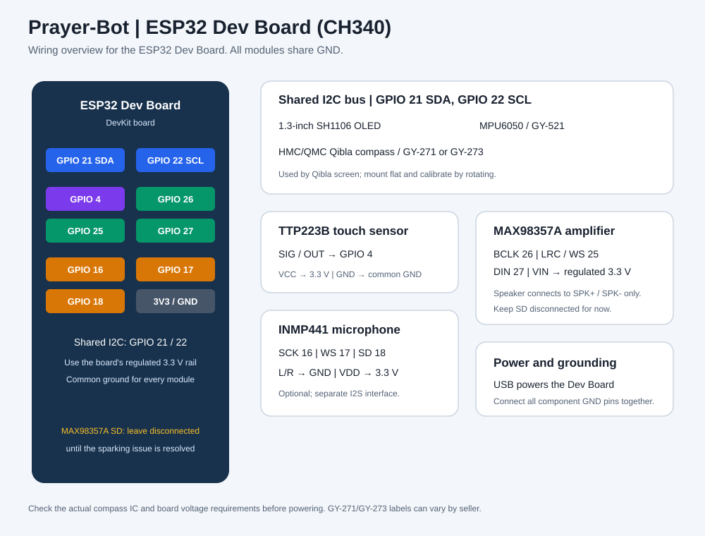

# Prayer-Bot Circuit and Wiring

[📄 **README**](README.md) | [🔧 **Hardware Connections**](HARDWARE_CONNECTIONS.md) | [📐 **Circuit Diagram**](CIRCUIT.md)

Build a DIY ESP32 prayer clock with this circuit diagram and wiring guide. The project uses an ESP32 Dev Board (CH340), an OLED display, touch controls, motion and compass sensors, and audio modules. Its power setup also includes an LM2596S adjustable buck converter and a TP4056 single-cell battery charging module.

## ESP32 prayer clock circuit diagram

This visual overview shows how the main Prayer-Bot modules fit together, including the battery charging and voltage-conversion parts. For exact ESP32 GPIO assignments, use the pin table below and the detailed [hardware connections guide](HARDWARE_CONNECTIONS.md); firmware pin numbers are defined in `configuration/prayer_bot_config.h`. Check the markings and ratings on your specific boards before connecting power, since module layouts and protection features can vary.

## Pin and signal map

| Module | Module pin | ESP32 connection | Notes |
|---|---|---:|---|
| OLED SH1106 (I²C) | SDA | GPIO 21 | Shared I²C data |
| OLED SH1106 (I²C) | SCL | GPIO 22 | Shared I²C clock |
| OLED | VCC / GND | 3.3 V / GND | I²C address `0x3C` |
| MPU6050 (I²C) | SDA / SCL | GPIO 21 / GPIO 22 | Shares the I²C bus; address `0x68` |
| MPU6050 | VCC / GND | 3.3 V / GND | Shake detection |
| HMC5883L / QMC5883L compass (GY-271 / GY-273 boards) | SDA / SCL | GPIO 21 / GPIO 22 | Shared I²C bus; Qibla screen; address `0x1E` / `0x0D`; verify the actual sensor IC |
| HMC5883L / QMC5883L compass (GY-271 / GY-273 boards) | VCC / GND | 3.3 V / GND | Confirm the exact breakout's voltage rating |
| HMC5883L / QMC5883L compass (GY-271 / GY-273 boards) | DRDY | Not connected | Optional data-ready output |
| TTP223B touch sensor | SIG / OUT | GPIO 4 | Active-HIGH touch input |
| TTP223B | VCC / GND | 3.3 V / GND | Screen navigation and touch actions |
| MAX98357A amplifier | BCLK | GPIO 26 | I²S bit clock |
| MAX98357A amplifier | LRC / WS | GPIO 25 | I²S word-select clock |
| MAX98357A amplifier | DIN | GPIO 27 | I²S audio data to amplifier |
| MAX98357A amplifier | VIN / GND | 3.3 V / GND | Confirm the module's supply range |
| MAX98357A amplifier | GAIN / SD | Not connected | Leave SD disconnected until the sparking issue is resolved |
| Speaker | SPK+ / SPK− | Amplifier SPK+ / SPK− | Connect directly to the amplifier output; neither lead is ground |
| INMP441 microphone (optional) | SCK | GPIO 16 | Separate microphone I²S interface |
| INMP441 microphone (optional) | WS | GPIO 17 | Word-select clock |
| INMP441 microphone (optional) | SD | GPIO 18 | Microphone data into ESP32 |
| INMP441 microphone (optional) | L/R | GND | Select left channel |
| INMP441 microphone (optional) | VDD / GND | 3.3 V / GND | Do not power the microphone from 5 V |
| LM2596S adjustable buck converter | IN+ / IN− | Suitable higher-voltage DC source / common ground | Step-down only; input must exceed the selected output |
| LM2596S adjustable buck converter | OUT+ / OUT− | Regulated power rail / common ground | Verify the output with a multimeter before connecting a load |
| TP4056 charging module | IN+ / IN− | Regulated 5 V input / common ground | Single-cell Li-ion/LiPo charger; check your module's specifications |
| TP4056 charging module | B+ / B− | Compatible battery + / battery − | Observe polarity; battery protection depends on module version |
| TP4056 charging module | OUT+ / OUT− (if fitted) | Protected battery output on supported versions | Not present or protected on every TP4056 board |

## Power and assembly notes

- Power the ESP32 Dev Board through its USB connector or a regulated supply appropriate for the development board. Use its regulated 3.3 V rail for the logic modules listed above.
- Connect all module grounds to a common ground. Do not connect the MAX98357A speaker output terminals to ground or to each other.
- Keep I²C wires short. Use 3.3 V-compatible I²C pull-ups; many breakout boards already include them.
- All three I²C devices use GPIO 21 (SDA) and GPIO 22 (SCL). The firmware initializes the OLED and MPU6050 and reads either supported compass chip for the Qibla screen.
- Mount the HMC5883L or QMC5883L flat, with X toward the display's right edge and Y toward its top edge. Keep it level and rotate slowly through about 270° on the Qibla screen to calibrate. The bearing uses zero magnetic declination and is approximate.
- The optional INMP441 is required for voice capture on the device. Dashboard voice input instead uses the phone or computer browser microphone.
- The firmware assigns the microphone to I²S port 0 and the amplifier to I²S port 1. Do not interchange their GPIO wiring.
- The LM2596S only steps voltage down. A single-cell battery charged by the TP4056 is below 5 V, so it cannot supply a regulated 5 V output through the LM2596S; use an appropriate boost/boost-buck converter or a higher-voltage input source.
- Set and meter the LM2596S output before connecting the ESP32. A basic TP4056 is a charger, not a load-sharing power supply; verify the exact module's protection and operating instructions before powering a load while charging. Do not connect USB and external power simultaneously unless the ESP32 board supports it.
- The GPIO assignments here match the firmware and [HARDWARE_CONNECTIONS.md](HARDWARE_CONNECTIONS.md). Confirm the silkscreen and voltage limits of your exact breakout boards before powering them.

See [HARDWARE_CONNECTIONS.md](HARDWARE_CONNECTIONS.md) for additional assembly guidance and the full wiring table.
