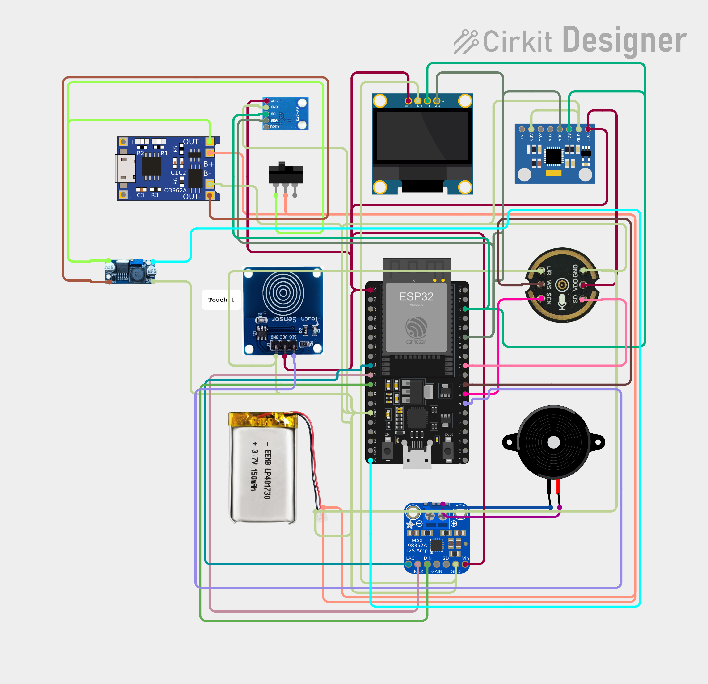

<div align="center">

# Prayer-Bot

### An open-source ESP32 prayer clock and personal assistant.

**Board Specification:** Target hardware is an **ESP32 Dev Board with a CH340 USB-to-serial interface**.

Prayer-Bot brings prayer times, a Hijri calendar, weather, Quran audio, Dhikr, and Pomodoro focus sessions together in one DIY project. Build it, learn how it works, and make it your own.

[](https://platformio.org/)
[](https://github.com/mr-tanzim-ahmed/Prayer-Bot/releases/tag/v1.0.1)
[](LICENSE)
[](https://docs.platformio.org/en/latest/frameworks/arduino.html)

[🚀 Build and setup guide](SETUP_GUIDE.md) · [🔧 Hardware and wiring](HARDWARE_CONNECTIONS.md) · [📐 Circuit diagram](CIRCUIT.md)

**[Open the interactive circuit simulation in Cirkit Designer](https://app.cirkitdesigner.com/project/8c737eb1-cfbb-4785-aa51-3c7f796c5155)**

<br>

<a href="CIRCUIT.md"></a>

<sub>A DIY ESP32 prayer clock with an OLED display, touch controls, compass, motion sensing, and audio · <a href="CIRCUIT.md">See the circuit diagram and wiring guide</a></sub>

</div>

---

## Explore the project

| 🚀 Get started | 🧭 Features and hardware | 🛠️ Build and contribute |
|---|---|---|
| [Build and set up your device](#build-and-set-up-your-device) | [What Prayer-Bot can do](#what-prayer-bot-can-do) | [Explore the firmware](#explore-the-firmware) |
| [Hardware and wiring](#hardware-and-wiring) | [Use the device controls](#use-the-device-controls) | [Technical notes for developers](#technical-notes-for-developers) |
| [Online services and API keys](#online-services-and-api-keys) | [Circuit diagram](CIRCUIT.md) · [Simulation](https://app.cirkitdesigner.com/project/8c737eb1-cfbb-4785-aa51-3c7f796c5155) | [Contribute](#contribute) |

> **Expandable sections:** Select a heading marked **▸ VIEW DETAILS** to open it.

## What Prayer-Bot can do

Prayer-Bot is a DIY **ESP32 prayer clock and personal assistant**. Use the OLED and touch sensor on your desk, or open the local web dashboard from a phone or computer connected to the same network.

| On the device | In the web dashboard | Built for developers |
|---|---|---|
| 🕌 Prayer focus and daily prayer schedule | 📱 Local dashboard and device controls | ⚙️ Modular C++ managers and screens |
| 🗓️ Clock, Gregorian/Hijri calendar, and events | 📍 Location, calculation, and device settings | 🧵 FreeRTOS tasks for display, network, and audio |
| 🧭 Qibla bearing and live compass direction | 📈 Seven-day Pomodoro history | 💾 LittleFS settings and cached data |
| ⏱️ Pomodoro focus timer and Dhikr counter | 🎧 Quran Surah requests by voice or text | 🔌 Aladhan, OpenWeatherMap, Gemini, and MP3Quran |
| 🔊 Azan notification tone and Quran audio | 🕹️ Screen, timer, Dhikr, and audio controls | 🔐 API keys stay on the device |

The device has eight OLED screens: Prayer Focus, All Prayers, Clock & Calendar, Qibla, Weather, Pomodoro, Dhikr, and Quran.

<details>
<summary><strong>🧭 Qibla screen: calibration and accuracy</strong> <kbd>▸ VIEW DETAILS</kbd></summary>

The Qibla screen uses an HMC5883L or QMC5883L compass and shows a smoothed arrow toward Makkah. It does not display a bearing or turn angle. At the default Dhaka coordinates, the calculated bearing is 277.6°; other locations use their configured latitude and longitude. The screen provides guidance if the compass, location, or calibration is not ready.

On first use, keep the device level and slowly rotate it through a full 360° turn. Calibration is saved only after readings cover all directions. A figure-eight can help expose the sensor to different directions, but keep it level while calibrating. Long-press the touch sensor on the Qibla screen to recalibrate. The bearing uses zero magnetic declination and is approximate; the firmware does not compensate for tilting the device. Keep the compass away from speakers, motors, magnets, and metal, as interference or incorrect sensor orientation can reduce accuracy. You can set a different location in the dashboard or use its permission-based device-location option.

</details>

<details>
<summary><strong>🔊 Audio behavior and safe testing</strong> <kbd>▸ VIEW DETAILS</kbd></summary>

Touch feedback plays an MP3 embedded in program flash, so it does not need a filesystem upload. Short notification and prayer-alarm tones use a faded sine waveform. Touch feedback is skipped during Quran playback and interrupted by the Azan alarm.

When testing the MAX98357A and speaker, start at a low device volume and raise it gradually. Never connect either speaker output terminal to ground.

</details>

<details>
<summary><strong>📶 First connection: setup Wi-Fi</strong> <kbd>▸ VIEW DETAILS</kbd></summary>

The setup hotspot is **`Prayer-Bot`** (password: **`12345678`**) at **`http://10.77.0.1`**. A phone or laptop may show a captive-portal prompt when it connects; if it does not, open that address in a browser. Use `https://10.77.0.1` only after installing dashboard certificates. After you connect the device to home Wi-Fi, its router-side address is assigned by DHCP.

</details>

While **All Prayers** is selected, the OLED shows the five daily prayers in rows for 3 seconds, then Sahari end (Fajr) and Iftar (Maghrib) for 2 seconds. This 5-second cycle repeats until you choose another screen. The dashboard schedule also shows Sahari end and Iftar using that day's Fajr and Maghrib times.

At startup, the OLED displays a centered “Assalamualaikum” greeting and its translation.

> **Audio note:** The Azan alert is a repeating notification tone; recorded Adhan audio is not included. The Quran assistant identifies Surah requests, but does not provide translations, tafsir, or free-form Quran-text search.

## 🚀 Build and set up your device

Follow the **[Prayer-Bot Setup Guide](SETUP_GUIDE.md)** for the complete walkthrough: install VS Code and PlatformIO, configure optional secrets, build and upload the firmware, connect to Wi-Fi, and open the dashboard.

Before powering the board, review the [hardware connections](HARDWARE_CONNECTIONS.md) and [circuit diagram](CIRCUIT.md). PlatformIO installs the dependencies in [`platformio.ini`](platformio.ini) during the first build.

## 🧩 Explore the firmware

The firmware groups feature logic into C++ managers and keeps OLED presentation in separate screen modules. If you are new to the code, start with [`src/main.cpp`](src/main.cpp) to see how the device starts and coordinates its FreeRTOS tasks. To change a feature, find its area below:

| To work on… | Start with… |
|---|---|
| Startup, task scheduling, or module coordination | [`src/main.cpp`](src/main.cpp) |
| Pins, defaults, timing, or API endpoints | [`include/core/config.h`](include/core/config.h) |
| Prayer schedules and prohibited-time windows | [`include/managers/prayer/prayer_manager.h`](include/managers/prayer/prayer_manager.h), [`src/managers/prayer/prayer_manager.cpp`](src/managers/prayer/prayer_manager.cpp) |
| Device inputs, sensors, display, and I²C | [`include/managers/device/`](include/managers/device/), [`src/managers/device/`](src/managers/device/) |
| Voice recognition, Quran playback, audio output, and notification tones | [`include/managers/audio/azan_manager.h`](include/managers/audio/azan_manager.h), [`src/managers/audio/azan_manager.cpp`](src/managers/audio/azan_manager.cpp), [`include/audio/touch_beep_audio.h`](include/audio/touch_beep_audio.h) |
| Pomodoro state and weekly statistics | [`src/managers/productivity/pomodoro_manager.cpp`](src/managers/productivity/pomodoro_manager.cpp), [`src/managers/productivity/pomodoro_stats.cpp`](src/managers/productivity/pomodoro_stats.cpp) |
| Wi-Fi, weather, or outbound network clients | [`include/managers/network/`](include/managers/network/), [`include/network/`](include/network/) |
| Settings, LittleFS, or caches | [`include/managers/storage/`](include/managers/storage/), [`src/managers/storage/`](src/managers/storage/) |
| Dashboard routes or HTTPS listener | [`include/managers/web/`](include/managers/web/), [`src/managers/web/`](src/managers/web/) |
| OLED presentation and screen routing | [`src/screens/`](src/screens/), [`include/screens/`](include/screens/), [`src/managers/ui/screen_router.cpp`](src/managers/ui/screen_router.cpp) |

### Project layout

<details>
<summary><strong>📁 Browse the source tree</strong> <kbd>▸ VIEW DETAILS</kbd></summary>

```text
Prayer-Bot/
|-- include/                         Public headers and interfaces
|   |-- audio/
|   |   `-- touch_beep_audio.h
|   |-- core/
|   |   |-- config.h
|   |   |-- secrets.h.example
|   |   `-- types.h
|   |-- managers/                    Manager interfaces grouped by responsibility
|   |   |-- audio/
|   |   |   |-- azan_manager.h
|   |   |   `-- voice_manager.h
|   |   |-- device/
|   |   |   |-- button_handler.h
|   |   |   |-- compass_manager.h
|   |   |   |-- display_manager.h
|   |   |   |-- i2c_bus.h
|   |   |   `-- shake_detector.h
|   |   |-- diagnostics/
|   |   |   `-- logger.h
|   |   |-- network/
|   |   |   |-- weather_manager.h
|   |   |   `-- wifi_manager.h
|   |   |-- prayer/
|   |   |   |-- calendar_manager.h
|   |   |   `-- prayer_manager.h
|   |   |-- productivity/
|   |   |   |-- pomodoro_manager.h
|   |   |   `-- pomodoro_stats.h
|   |   |-- storage/
|   |   |   |-- cache_manager.h
|   |   |   `-- storage_manager.h
|   |   |-- ui/
|   |   |   `-- screen_router.h
|   |   `-- web/
|   |       |-- https_server_manager.h
|   |       `-- web_server_manager.h
|   |-- network/
|   |   `-- https_client.h
|   |-- screens/                     OLED screen interfaces
|   |   |-- all_prayers_screen.h
|   |   |-- clock_calendar_screen.h
|   |   |-- dhikr_screen.h
|   |   |-- pomodoro_screen.h
|   |   |-- prayer_focus_screen.h
|   |   |-- qibla_screen.h
|   |   |-- screen_ui.h
|   |   |-- surah_screen.h
|   |   |-- weather_icons.h
|   |   `-- weather_screen.h
|   `-- web/
|       `-- dashboard_html.h
|-- src/                              Firmware implementations
|   |-- main.cpp                      Startup, task creation, and dependency wiring
|   |-- managers/                     Implementations matching include/managers/
|   |   |-- audio/
|   |   |   |-- azan_manager.cpp
|   |   |   `-- voice_manager.cpp
|   |   |-- device/
|   |   |   |-- button_handler.cpp
|   |   |   |-- compass_manager.cpp
|   |   |   |-- display_manager.cpp
|   |   |   |-- i2c_bus.cpp
|   |   |   `-- shake_detector.cpp
|   |   |-- diagnostics/
|   |   |   `-- logger.cpp
|   |   |-- network/
|   |   |   |-- weather_manager.cpp
|   |   |   `-- wifi_manager.cpp
|   |   |-- prayer/
|   |   |   |-- calendar_manager.cpp
|   |   |   `-- prayer_manager.cpp
|   |   |-- productivity/
|   |   |   |-- pomodoro_manager.cpp
|   |   |   `-- pomodoro_stats.cpp
|   |   |-- storage/
|   |   |   |-- cache_manager.cpp
|   |   |   `-- storage_manager.cpp
|   |   |-- ui/
|   |   |   `-- screen_router.cpp
|   |   `-- web/
|   |       |-- https_server_manager.cpp
|   |       `-- web_server_manager.cpp
|   `-- screens/                     OLED screen implementations
|       |-- all_prayers_screen.cpp
|       |-- clock_calendar_screen.cpp
|       |-- dhikr_screen.cpp
|       |-- pomodoro_screen.cpp
|       |-- prayer_focus_screen.cpp
|       |-- qibla_screen.cpp
|       |-- surah_screen.cpp
|       `-- weather_screen.cpp
|-- data/                             LittleFS assets; local certificates/keys are ignored
|   |-- beep_sound.mp3
|   `-- PrayerBot_Arrow.svg
|-- Prayer-Bot.ino                    Arduino IDE entry point
|-- platformio.ini                    PlatformIO board and dependency configuration
|-- README.md
|-- SETUP_GUIDE.md
|-- HARDWARE_CONNECTIONS.md
|-- CIRCUIT.md
`-- circuit_image.png
```

</details>

Shared state and screen IDs live in [`include/core/types.h`](include/core/types.h). Each manager's public interface is in `include/managers/<area>/`, with its implementation in the matching `src/managers/<area>/` folder. `main.cpp` connects and initializes the modules and creates FreeRTOS tasks. Screen modules handle presentation; managers handle hardware, feature behavior, and external services.

Use [`StorageManager`](src/managers/storage/storage_manager.cpp) for persistent application data and [`CacheManager`](src/managers/storage/cache_manager.cpp) for cache freshness and retention. Outbound HTTP clients live in `include/network/`, dashboard assets in `include/web/`, and generated or private filesystem assets in the ignored `data/` directory. When you add a feature, put its interface and implementation in the right area, update its callers, and add or update a screen when needed. Keep dependencies explicit and update this map when public paths change.

## 🔌 Hardware and wiring

This ESP32 prayer clock brings together a display, touch input, sensors, and audio in one build. The circuit diagram shows the overall hardware layout, including the LM2596S adjustable buck converter and TP4056 battery charger. The INMP441 microphone is optional and only needed for on-device voice selection; browser voice input uses the microphone on your phone or computer.

| Part | Role | Required? |
|---|---|---|
| ESP32 Dev Board (CH340) | Main controller, Wi-Fi, and storage | Yes |
| 1.3-inch I²C SH1106 OLED | Device screens | Yes |
| TTP223B capacitive touch sensor | Screen navigation and quick actions | Yes |
| MPU6050 / GY-521 | Shake controls | Yes |
| HMC5883L or QMC5883L compass (GY-271 / GY-273 boards) | Qibla screen compass direction and bearing | Required for Qibla; optional for other features |
| MAX98357A I²S amplifier + speaker | Alerts and Quran audio | Yes for device audio |
| INMP441 I²S microphone | On-device Surah voice selection | Optional |
| LM2596S adjustable buck converter | Regulates a suitable higher-voltage DC input for the power setup | Used in this build's power setup |
| TP4056 charging module | Charges a compatible single-cell Li-ion/LiPo battery | Used in this build's power setup |

<details>
<summary><strong>📍 GPIO pin map and wiring notes</strong> <kbd>▸ VIEW DETAILS</kbd></summary>

| Signal | ESP32 GPIO |
|---|---:|
| OLED + MPU6050 + compass I²C SDA | 21 |
| OLED + MPU6050 + compass I²C SCL | 22 |
| Capacitive touch output | 4 |
| MAX98357A BCLK / LRC (WS) / DIN | 26 / 25 / 27 |
| INMP441 SCK / WS / SD | 16 / 17 / 18 |

The OLED, MPU6050, and optional compass share an I²C bus; the MAX98357A amplifier and INMP441 microphone use separate I²S connections. Use 3.3 V-compatible logic and connect the modules to a common ground. **Do not connect either speaker output terminal to ground.** If the amplifier or wiring sparks, disconnect power to the amplifier and speaker and do not reconnect them until the cause has been found; leaving SD disconnected does not make a short safe. Check the voltage requirements printed on your specific breakout boards before applying power.

The LM2596S is a step-down converter only: its input must be higher than its set output. A TP4056 charges a single-cell battery below 5 V, so it cannot feed the LM2596S to create a 5 V ESP32 supply. Use a suitable boost/boost-buck converter for that battery-powered arrangement, or a higher-voltage source for the LM2596S. Set and verify converter output with a multimeter before connecting the board. A basic TP4056 is not a load-sharing power supply; verify the exact board's protection and charging instructions, and do not connect USB and external power together unless the ESP32 board supports it.

The [Prayer-Bot circuit diagram](CIRCUIT.md) is a visual overview, not a substitute for checking each board's pin labels, voltage limits, or protection circuitry. Use the wiring table in [HARDWARE_CONNECTIONS.md](HARDWARE_CONNECTIONS.md) for the firmware GPIO connections.

The compass driver supports HMC5883L sensors at I²C address `0x1E` and QMC5883L sensors at `0x0D`, auto-detecting which chip is fitted. The sensor is expected to be mounted flat with its X axis toward the display's right edge and Y axis toward the top edge. The firmware checks the HMC5883L identity or verifies QMC5883L configuration, rejects overflow or stale readings, retries sensor communication, and requests a full-turn calibration before showing the arrow. Calibration corrects hard-iron offsets, but does not correct soft-iron distortion, tilt, or local magnetic declination. The displayed true-north bearing is therefore approximate, not guaranteed to be within a particular percentage or degree error. The firmware also expects the OLED at `0x3C` and MPU6050 at `0x68`; unlike the supplied diagnostic, it does not try alternate addresses.

See [HARDWARE_CONNECTIONS.md](HARDWARE_CONNECTIONS.md) for full wiring notes and [CIRCUIT.md](CIRCUIT.md) for the illustrated connection reference. Pin assignments are defined in [`include/core/config.h`](include/core/config.h).

</details>

## 🌐 Online services and API keys

Prayer schedules come from Aladhan and do not need a personal API key. Weather and air-quality features use an optional OpenWeatherMap key; Quran request recognition uses an optional Gemini key. Keep optional keys in the local, Git-ignored `include/core/secrets.h` file. The [Setup Guide](SETUP_GUIDE.md#api-keys) explains how to add them safely.

Prayer schedules are fetched as a monthly calendar and cached on the device. You need a network connection for the first fetch and when a new month is loaded; the timetable is not preloaded for offline use. Weather and prayer data refresh when the device is online. The default location is Dhaka, Bangladesh (23.8103, 90.4125), in `Asia/Dhaka` (UTC+6).

## 🎛️ Use the device controls

Use the touch sensor for everyday actions, or open the dashboard from a phone or computer on the same network as the device.

| What you do | What happens |
|---|---|
| Tap touch sensor | Advance OLED screen; on Dhikr, increment the count |
| Shake device | Dismiss an active Azan alert; control playback/timer on the relevant screen |
| Hold touch for 3 seconds on Pomodoro | Start or pause/resume the timer |
| Tap during a Pomodoro break-ready prompt | Start the break |
| Dashboard controls | Select screens, control timer and Dhikr, and manage Quran playback |

<details>
<summary><strong>⏱️ Pomodoro timer: defaults and behavior</strong> <kbd>▸ VIEW DETAILS</kbd></summary>

- Defaults: **25-minute focus**, **5-minute short break**, **15-minute long break** after **4** focus cycles.
- The touch-started break delay is configurable from **2 to 5 minutes**.
- At focus completion, the device beeps and waits for a touch or dashboard action before starting the break. Focus resumes automatically after the break.
- A shake starts an idle timer or pauses/resumes an active timer while the Pomodoro screen is open. A shake does not start a break that is waiting for touch.
- The dashboard’s seven-day history tracks sessions started, completed focus sessions, and completed focus minutes. Partial or interrupted focus sessions do not count as completed.

</details>

<details>
<summary><strong>📿 Dhikr counter: phrases and meanings</strong> <kbd>▸ VIEW DETAILS</kbd></summary>

| Phrase | Meaning |
|---|---|
| Subhan Allah | Glory be to Allah |
| Alhamdulillah | Praise be to Allah |
| La ilaha illallah | There is no deity except Allah |
| Allahu Akbar | Allah is the Greatest |
| Astaghfirullah | I seek Allah’s forgiveness |

The OLED cycles through English transliterations and meanings, so no Arabic font or image assets are needed.

</details>

## ⚙️ Technical notes for developers

- **Board:** PlatformIO uses the `esp32dev` profile for the ESP32 Dev Board (CH340). Board variants may differ in flash size and pin availability.
- **Flash layout:** The 4 MB target uses `no_ota.csv`: one 2 MB firmware slot and about 1.875 MB for LittleFS. This preserves the current feature set but does not support A/B OTA updates. Changing from the default partition layout changes the LittleFS offset; back up settings and Wi-Fi credentials, then re-upload the LittleFS image after changing layouts.
- **Memory:** The ESP32 Dev Board target has no PSRAM by default. Microphone I²S DMA buffers are sized for this target, and dashboard voice uploads use PSRAM when available with an internal-RAM fallback; very large uploads can still be rejected if the largest available memory block is too small.
- **Framework and dependencies:** Arduino framework with dependency versions pinned in [`platformio.ini`](platformio.ini).
- **Concurrency:** FreeRTOS tasks coordinate display rendering, networking, scheduling, audio, and voice features.
- **Persistent data:** Settings, cached responses, and bounded Pomodoro history are stored in LittleFS. Prayer and weather cache files have expiry policies; interrupted atomic writes leave `.tmp` files that are cleaned at startup. Serial startup logs report filesystem usage. Back up device settings before replacing or erasing the filesystem.
- **JSON and web requests:** ArduinoJson handles service responses. Dashboard request bodies are size-limited and validated before settings are applied.

## 🤝 Contribute

Have an idea, found a bug, or want to improve the project? Issues and pull requests are welcome. Keep feature logic in its responsible manager or screen, follow the existing pin and configuration conventions, and update the README or wiring guide when behavior changes.

---

<div align="center">

**Ready to build your ESP32 prayer clock?** Start with the [VS Code and PlatformIO setup guide](SETUP_GUIDE.md), then follow the [hardware and wiring guide](HARDWARE_CONNECTIONS.md).

Made to be built, understood, and extended. · [MIT License](LICENSE)

</div>
