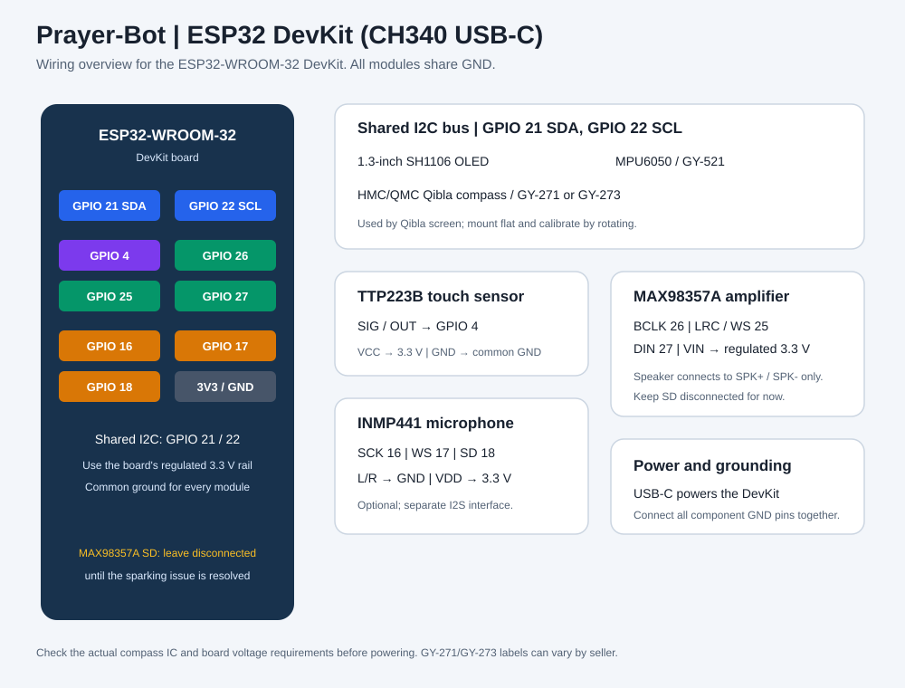

<div align="center">

# Prayer-Bot

### An open-source ESP32-S3 Islamic prayer clock with a Quran assistant and focus dashboard.

Prayer-Bot brings prayer times, a Hijri calendar, weather, Quran audio, Dhikr, and Pomodoro focus sessions together in a DIY project you can build, understand, and customize.

[](https://platformio.org/)
[](LICENSE)
[](https://docs.platformio.org/en/latest/frameworks/arduino.html)
[](platformio.ini)
[](platformio.ini)

[Get started](#-get-started) · [Explore features](#-what-it-can-do) · [Hardware guide](HARDWARE_CONNECTIONS.md) · [Circuit diagram](CIRCUIT.md)

<br>

<a href="CIRCUIT.md"></a>

<sub>ESP32-S3 prayer clock with OLED display, touch controls, motion sensing, and audio · <a href="CIRCUIT.md">Explore the circuit and wiring</a></sub>

</div>

---

## ✨ Features

Prayer-Bot is a DIY **ESP32-S3 prayer clock and Islamic personal assistant**. Use its OLED and touch sensor on your desk, or open its local web dashboard from a phone or computer on the same network.

| On the device | In the web dashboard | Built for developers |
|---|---|---|
| 🕌 Prayer focus and daily prayer schedule | 📱 Local dashboard and device controls | ⚙️ Modular C++ managers and screens |
| 🗓️ Clock, Gregorian/Hijri calendar, and events | 📍 Location, calculation, and device settings | 🧵 FreeRTOS tasks for display, network, and audio |
| 🌤️ Weather and air quality | 📈 Seven-day Pomodoro history | 💾 LittleFS settings and cached data |
| ⏱️ Pomodoro focus timer and Dhikr counter | 🎧 Quran Surah requests by voice or text | 🔌 Aladhan, OpenWeatherMap, Gemini, and MP3Quran |
| 🔊 Azan notification tone and Quran audio | 🕹️ Screen, timer, Dhikr, and audio controls | 🔐 API keys stay on the device |

**Seven OLED screens:** Prayer Focus · All Prayers · Clock & Calendar · Weather · Pomodoro · Dhikr · Quran.

> **Audio note:** The Azan alert is a repeating notification tone. Recorded Adhan audio is not included. The Quran assistant identifies Surah requests; it does not provide Quran translation, tafsir, or free-form Quran-text search.

## 🚀 Build your Prayer-Bot

Follow these steps to build and run the ESP32-S3 firmware. The [hardware guide](HARDWARE_CONNECTIONS.md) has the full wiring table; check it before connecting modules.

### Tools and parts you’ll need

**Required software**

- A computer running Windows, macOS, or Linux
- [Visual Studio Code](https://code.visualstudio.com/) with the [PlatformIO IDE extension](https://marketplace.visualstudio.com/items?itemName=platformio.platformio-ide), **or** [PlatformIO Core CLI](https://docs.platformio.org/en/latest/core/installation/index.html)
- A USB data cable for your ESP32-S3 (some cables provide power only)

**Required board and hardware**

- ESP32-S3 DevKitC-1 **N16R8** board (16 MB flash, 8 MB PSRAM)
- The display, touch sensor, motion sensor, amplifier, and speaker listed in the [hardware guide](HARDWARE_CONNECTIONS.md)
- An INMP441 microphone only if you want voice selection on the device; dashboard voice input uses your phone or computer microphone

**Optional credentials:** OpenWeatherMap enables weather and air-quality readings; Google Gemini enables Surah recognition. The firmware can be built without working keys, but those online features will not work until you configure them. See [API key setup](#-set-up-api-keys-safely).

### Software tools and libraries

PlatformIO is the project’s build and dependency manager. When you first build, it reads [`platformio.ini`](platformio.ini) and automatically downloads the ESP32 platform, Arduino framework, compiler/upload tools, and pinned libraries below. **You do not need to install these libraries separately** or use Arduino Library Manager.

| Library | Version | Used for |
|---|---:|---|
| [ESPAsyncWebServer](https://registry.platformio.org/libraries/mathieucarbou/ESPAsyncWebServer) | 3.6.0 | Local web dashboard and asynchronous HTTP server |
| [AsyncTCP](https://registry.platformio.org/libraries/mathieucarbou/AsyncTCP) | 3.3.2 | Asynchronous networking used by the web server |
| [U8g2](https://registry.platformio.org/libraries/olikraus/U8g2) | 2.36.18 | OLED display rendering |
| [Adafruit MPU6050](https://registry.platformio.org/libraries/adafruit/Adafruit%20MPU6050) | 2.2.9 | MPU6050 accelerometer/gyroscope |
| [Adafruit Unified Sensor](https://registry.platformio.org/libraries/adafruit/Adafruit%20Unified%20Sensor) | 1.1.15 | Common sensor interface required by the MPU6050 library |
| [Adafruit BusIO](https://registry.platformio.org/libraries/adafruit/Adafruit%20BusIO) | 1.17.4 | Bus support required by Adafruit sensor drivers |
| [ESP8266Audio](https://registry.platformio.org/libraries/earlephilhower/ESP8266Audio) | 2.2.0 | Quran audio decoding and I²S playback |
| [ArduinoJson](https://registry.platformio.org/libraries/bblanchon/ArduinoJson) | 7.4.3 | Parsing and generating JSON for APIs and settings |

Wi-Fi, HTTP client, LittleFS, FreeRTOS, I²S, and other core functions are provided by the ESP32 Arduino framework or ESP32 platform; they are not separate PlatformIO libraries in this project.

### 1. Open the project and add your private keys

Clone or download this repository, open its folder in VS Code, and create a local secrets file from the example:

```powershell
Copy-Item src\secrets.h.example src\secrets.h
```

Edit `src/secrets.h` and add your own API keys. **If the file already exists, do not overwrite it**—keep your current credentials. The [API key guide](#-configure-api-keys) explains which services need keys and how to protect them.

### 2. Build, upload, and view serial logs

Open a terminal in the repository root. With PlatformIO IDE installed, use the VS Code integrated terminal; with PlatformIO Core installed, use your normal terminal. Run:

```sh
pio run
pio run --target upload
pio device monitor -b 115200
```

The first `pio run` may take a few minutes while PlatformIO downloads the platform, toolchain, framework, and libraries. Subsequent builds reuse those downloads. Connect the ESP32-S3 with a USB data cable before uploading; if more than one board is connected, specify its port with `--upload-port`, for example `pio run --target upload --upload-port COM5` on Windows. The serial monitor runs at **115200 baud** and shows startup and connection messages. Close it before uploading again.

<details>
<summary><strong>Prefer VS Code buttons?</strong></summary>

Prefer a graphical workflow? Install the **PlatformIO IDE** extension in VS Code, open this repository folder, then use the PlatformIO **Build**, **Upload**, and **Monitor** actions. PlatformIO installs project dependencies automatically on the first build. The monitor baud rate is **115200**.

PlatformIO is the canonical build system and installs the pinned dependencies from [`platformio.ini`](platformio.ini). The root `Prayer-Bot.ino` is an Arduino IDE entry point for the modular sources under `src/`, not a standalone single-file build.

</details>

### 3. Connect the device to Wi-Fi and open the dashboard

1. Power on the ESP32-S3. On your phone or computer, join the device’s **Prayer-Bot** setup Wi-Fi (default password: `12345678`).
2. Tap the captive-portal notification to open setup. If it does not appear, visit **http://192.168.4.1** while connected to the setup Wi-Fi.
3. Enter the name (SSID) and password for a **2.4 GHz Wi-Fi router or phone hotspot**, then select **Connect to Wi-Fi**.
4. Once connected, find the ESP32’s home-network IP on the dashboard or in your router’s connected-device list.
5. Connect your browser device to the same network, open the ESP32’s IP address, then set your location and preferences. **Dhaka is the default location.**

The ESP32’s home-network IP is assigned by DHCP and can change. Your phone or computer must be on the same network as the ESP32 to open its local dashboard. Some phones cannot reach devices connected to their own hotspot; if that happens, try another phone or computer connected to the hotspot.

<details>
<summary><strong>First boot, dashboard, and offline behavior</strong></summary>

- The setup hotspot remains active while the device connects to your router. Wi-Fi scans can fill in the SSID, but you must enter the password yourself.
- The device checks for router association, a DHCP address, and a gateway before saving new credentials. It verifies the saved values and restarts after a successful setup. The connection attempt can take up to 35 seconds.
- Router connection does not guarantee internet access. Prayer schedules, weather, speech recognition, and streaming Quran audio require internet.
- The dashboard provides device status, prayer times, prohibited-time windows, Hijri date, weather/AQI, screen selection, Pomodoro controls/history, Dhikr controls, Quran playback, Wi-Fi setup, and device settings.
- Browser voice input requires microphone permission and browser speech-recognition support; English and Bangla are available. The browser sends the transcript to the ESP32, which uses Gemini to identify the request. The API key is not sent to browser code.
- Pomodoro and Dhikr work locally when offline; internet-backed voice and audio controls are unavailable.
- The dashboard can initialize device time from the connected phone or computer. NTP synchronizes the clock when internet is available.

</details>

## 🧭 Where to start in the code

The firmware uses focused C++ managers for feature logic and separate modules for the OLED screens. If you are new to the codebase, start with `src/main.cpp` to see how the device starts up and coordinates its FreeRTOS tasks. For a feature change, begin in the matching manager or screen module:

| If you want to change… | Start here |
|---|---|
| Startup, task scheduling, or module coordination | [`src/main.cpp`](src/main.cpp) |
| Pins, defaults, timing, or API endpoints | [`src/config.h`](src/config.h) |
| Prayer schedules and prohibited-time windows | [`src/prayer_manager.h`](src/prayer_manager.h), [`src/prayer_manager.cpp`](src/prayer_manager.cpp) |
| Dashboard UI or its JSON API | [`src/dashboard_html.h`](src/dashboard_html.h), [`src/web_server_manager.cpp`](src/web_server_manager.cpp) |
| Voice recognition and Quran playback | [`src/voice_manager.cpp`](src/voice_manager.cpp), [`src/screens/`](src/screens/) |
| Pomodoro state and weekly statistics | [`src/pomodoro_manager.cpp`](src/pomodoro_manager.cpp), [`src/pomodoro_stats.cpp`](src/pomodoro_stats.cpp) |
| Settings, LittleFS, or caches | [`src/storage_manager.cpp`](src/storage_manager.cpp), [`src/cache_manager.cpp`](src/cache_manager.cpp) |
| OLED presentation | [`src/screens/`](src/screens/), [`src/screen_router.cpp`](src/screen_router.cpp) |

Shared state and screen IDs live in [`src/types.h`](src/types.h). Most managers have a matching `.h` interface and `.cpp` implementation. Keep feature behavior close to the module that owns it; use `main.cpp` to initialize services and connect them. If responsibilities or filenames change, update this map so the next contributor can find their way.

## 🧰 Hardware components and wiring

These are the main parts used by the ESP32-S3 prayer clock. The INMP441 microphone is optional; it is needed only for voice selection on the device itself. Browser voice input uses the phone or computer microphone.

| Part | Role | Required? |
|---|---|---|
| ESP32-S3 DevKitC-1 N16R8 | Main controller, Wi-Fi, and storage | Yes |
| 1.3-inch I²C OLED (SSD1306/SH1106) | Device screens | Yes |
| TTP223B capacitive touch sensor | Screen navigation and quick actions | Yes |
| MPU6050 / GY-521 | Shake controls | Yes |
| MAX98357A I²S amplifier + speaker | Alerts and Quran audio | Yes for device audio |
| INMP441 I²S microphone | On-device Surah voice selection | Optional |

<details>
<summary><strong>GPIO pin map</strong></summary>

| Signal | ESP32-S3 GPIO |
|---|---:|
| OLED + MPU6050 I²C SDA | 11 |
| OLED + MPU6050 I²C SCL | 12 |
| Capacitive touch output | 4 |
| MAX98357A BCLK / LRC (WS) / DIN | 5 / 6 / 7 |
| INMP441 SCK / WS / SD | 16 / 17 / 18 |

The OLED and MPU6050 share an I²C bus; the MAX98357A amplifier and INMP441 microphone use separate I²S connections. Use 3.3 V-compatible logic and connect the modules to a common ground. **Do not connect either speaker output terminal to ground.** Check the voltage requirements printed on your specific breakout boards before applying power.

See [HARDWARE_CONNECTIONS.md](HARDWARE_CONNECTIONS.md) for full wiring notes and [CIRCUIT.md](CIRCUIT.md) for the illustrated connection reference. Pin assignments are defined in [`src/config.h`](src/config.h).

</details>

## 🔐 Set up API keys safely

The firmware uses your OpenWeatherMap key for weather and air-quality data, and your Gemini key to recognize Quran Surah requests. Add both keys to the untracked local file `src/secrets.h`. Prayer times and Quran reciter metadata do not require keys from you.

1. If you do not already have the file, copy [`src/secrets.h.example`](src/secrets.h.example) to `src/secrets.h`.
2. Replace the Gemini and OpenWeatherMap placeholder strings with your own keys. Keep the quotation marks.
3. Build and upload the firmware. The keys are compiled into the device; they are not shown or editable in the dashboard.
4. Before committing your changes, confirm Git ignores the secrets file:

   ```sh
   git check-ignore src/secrets.h
   ```

**Never commit, screenshot, or share API keys.** If you accidentally expose a key, revoke it with its provider and create a replacement. When updating the project, keep your existing `src/secrets.h` rather than copying over it.

<details>
<summary><strong>Services and what they do</strong></summary>

| Service | Purpose | Key required? |
|---|---|---|
| [Aladhan](https://aladhan.com/prayer-times-api) | Monthly prayer timetable for the configured location and calculation method | No |
| [OpenWeatherMap](https://openweathermap.org/api) | Weather and air-pollution readings | Yes |
| [Google Gemini](https://aistudio.google.com/) | Recognizes typed or spoken Surah and Azan-notification requests | Yes |
| [MP3Quran v3](https://www.mp3quran.net/eng/api) | Reciter metadata and Quran audio sources | No |
| [MP3Quran Timing API](https://www.mp3quran.net/eng/timing-api) | Timed reciters and ayah progress for phone/browser playback | No |

Prayer schedules are fetched as a monthly calendar and cached on-device. A network connection is needed for the first fetch and later month refreshes; this is not a preloaded offline timetable. Weather and prayer data refresh when online. Default location: Dhaka, Bangladesh (23.8103, 90.4125), `Asia/Dhaka` (UTC+6).

</details>

## 🎛️ Touch, shake, and dashboard controls

Use the touch sensor for everyday controls, or use the dashboard when your phone or computer is on the same network as the device.

| What you do | What happens |
|---|---|
| Tap touch sensor | Advance OLED screen; on Dhikr, increment the count |
| Shake device | Dismiss an active Azan alert; control playback/timer on the relevant screen |
| Hold touch for 3 seconds on Pomodoro | Start or pause/resume the timer |
| Tap during a Pomodoro break-ready prompt | Start the break |
| Dashboard controls | Select screens, control timer and Dhikr, and manage Quran playback |

<details>
<summary><strong>Pomodoro behavior and settings</strong></summary>

- Defaults: **25-minute focus**, **5-minute short break**, **15-minute long break** after **4** focus cycles.
- The touch-started break delay is configurable from **2 to 5 minutes**.
- At focus completion, the device beeps and waits for a touch or dashboard action before starting the break. Focus resumes automatically after the break.
- A shake starts an idle timer or pauses/resumes an active timer while the Pomodoro screen is open. A shake does not start a break that is waiting for touch.
- The dashboard’s seven-day history tracks sessions started, completed focus sessions, and completed focus minutes. Partial or interrupted focus sessions do not count as completed.

</details>

<details>
<summary><strong>Dhikr phrases</strong></summary>

| Phrase | Meaning |
|---|---|
| Subhan Allah | Glory be to Allah |
| Alhamdulillah | Praise be to Allah |
| La ilaha illallah | There is no deity except Allah |
| Allahu Akbar | Allah is the Greatest |
| Astaghfirullah | I seek Allah’s forgiveness |

The OLED cycles through English transliterations and meanings; no Arabic font or image assets are required.

</details>

## 🧱 Firmware architecture and development notes

- **Board:** PlatformIO uses the ESP32-S3 DevKitC-1 profile with N16R8 settings: 16 MB flash and 8 MB PSRAM. Check your module before flashing; an N8 board may need a different configuration.
- **Framework and dependencies:** Arduino framework with dependency versions pinned in [`platformio.ini`](platformio.ini).
- **Concurrency:** FreeRTOS tasks coordinate display rendering, networking, scheduling, audio, and voice features.
- **Persistent data:** Settings, cached responses, and Pomodoro history are stored in LittleFS. Back up device settings before replacing or erasing the filesystem.
- **JSON and web requests:** ArduinoJson handles service responses. Dashboard request bodies are size-limited and validated before settings are applied.

## ❓ Common setup questions

<details>
<summary><strong>The setup page did not open. What should I try?</strong></summary>

While your phone or computer is connected to the **Prayer-Bot** setup Wi-Fi, open **http://192.168.4.1** in a browser. If the browser reports no internet, stay connected anyway; this network is only for configuring the device.

</details>

<details>
<summary><strong>I connected the ESP32 to Wi-Fi, but cannot find the dashboard.</strong></summary>

Check the dashboard, router, or serial monitor for the ESP32’s current home-network IP. Make sure your browser device is on the same router or hotspot. The IP may change after reconnecting. Some phone hotspots block access to connected devices from the hotspot owner; try a second device on that hotspot.

</details>

<details>
<summary><strong>Do prayer times and Quran audio work without internet?</strong></summary>

Prayer data already fetched by the device may be available from its cache, but the monthly timetable requires internet to fetch initially and refresh. Weather, Surah recognition, and Quran streaming also need internet. Dhikr and Pomodoro are available locally.

</details>

<details>
<summary><strong>Can I use a different ESP32-S3 board?</strong></summary>

The included PlatformIO configuration targets an ESP32-S3 DevKitC-1 with 16 MB flash and 8 MB PSRAM. Verify the flash size, PSRAM, pin availability, and voltage compatibility of your specific board before using it. Boards with different memory sizes may need configuration changes.

</details>

## 🤝 Contributing

Have an idea, found a bug, or want to improve the ESP32-S3 prayer clock? Issues and pull requests are welcome. Before submitting a change, keep feature logic in the responsible manager or screen, follow the existing pin and configuration conventions, and update the README or wiring documentation when behavior changes.

---

<div align="center">

**Ready to build your ESP32-S3 prayer clock?** Start with [Build your Prayer-Bot](#-build-your-prayer-bot), then follow the [hardware and wiring guide](HARDWARE_CONNECTIONS.md).

Made to be built, understood, and extended. · [MIT License](LICENSE)

</div>
